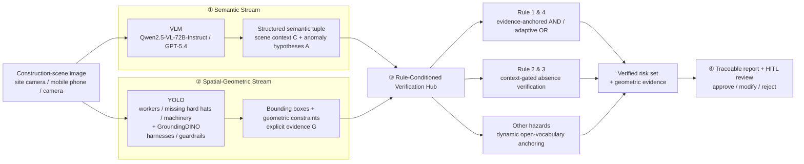

# Generate-then-Verify

**A training-free, evidence-grounded framework for trustworthy vision-language reasoning in safety-critical applications.**

Generate-then-Verify treats VLM-generated risk descriptions as preliminary hypotheses and verifies them against independent visual evidence from a multi-expert computer vision engine equipped with spatial-geometric reasoning.


---

## 📰 News

- **[v0.4] Benchmark & HITL study** — ConstructionSite-RB evaluation subset, trustworthiness metrics, and the Human-in-the-Loop auditing interface. *TBD.*
- **[v0.3] Rule-conditioned verification hub** — micro-object verification, context-gated absence verification, and dynamic open-vocabulary anchoring. *TBD.*
- **[v0.2] Multi-expert visual evidence engine** — YOLO + GroundingDINO detectors with spatial-geometric constraint modeling. *TBD.*
- **[v0.1] Semantic stream** — fixed-prompt VLM hypothesis generation with structured scene context and anomaly tuples. *Work in progress.*

---

## ✨ Overview

Vision-language models are increasingly applied to safety-critical decision support, where their outputs are consumed as inspection records rather than as free-form commentary. In construction safety management this exposes three reliability problems: hallucinated hazards that are not physically present, spatial descriptions that do not correspond to the scene, and conclusions that cannot be traced back to visual evidence. Supervised fine-tuning does not resolve them, because it optimizes the likelihood of reference text and never checks whether a claim is supported by the image.

Generate-then-Verify keeps the VLM frozen and relocates trust to an explicit verification stage. A Semantic Stream produces a structured scene context and a set of risk hypotheses. In parallel, a Spatial-Geometric Stream extracts localized evidence for workers, PPE, and machinery using a domain-specific YOLO detector for workers, missing hard hats, and machinery, together with GroundingDINO for the open-vocabulary localization of safety harnesses and guardrails. Bounding boxes are then converted into geometric evidence: shortest-edge distance to guardrails or machinery, containment of a harness centroid inside a worker box, and scale-normalized proximity constraints.

A Rule-Conditioned Verification Hub fuses the two streams with per-rule policies instead of a single monolithic ensemble. Micro-object and proximity hazards use evidence-anchored AND / adaptive OR verification; absence-based hazards such as missing harnesses are gated by the semantic scene context; long-tail hazards are anchored by turning the VLM description into a GroundingDINO text query. The result is a structured report in which every retained hazard carries the geometric evidence that justifies it, which a safety manager can approve, edit, or reject in a Human-in-the-Loop interface.

Unlike training-time alignment approaches that internalize a verifier into model weights, this framework performs no parameter update at deployment and leaves every rejection attributable to a named rule and a visible box — a property that matters when the decision itself has to be audited.

---

## 🏗️ Architecture



The VLM is used only as a semantic prior. No hazard enters the final report unless the verification hub either confirms it geometrically or explicitly retains it as a low-confidence candidate for human auditing.

---

## 🔍 Safety rules and verification policies

| Rule | Hazard category | Visually computable criterion |
| --- | --- | --- |
| Rule 1 | Missing PPE | Personnel not wearing a hard hat. |
| Rule 2 | Height work risk | Workers at visually significant elevated heights lacking safety harnesses or lanyards. |
| Rule 3 | Edge protection risk | Unprotected deep pits, trenches, or steep edges lacking guardrails or fences, exposing nearby workers to fall hazards. |
| Rule 4 | Machinery proximity | Workers standing dangerously close to excavators, e.g. within blind spots or operation radii. |
| Other | Open vocabulary | Long-tail hazards expressed as free-form descriptions and anchored by a GroundingDINO text query. |

Reference configuration used in the manuscript:

| Component | Setting |
| --- | --- |
| VLM backbones | Qwen2.5-VL-72B-Instruct (open-source), GPT-5.4 (closed-source) |
| Person detection confidence | 0.55 |
| Missing hard hat confidence | 0.08 |
| GroundingDINO box threshold, guardrails | 0.55 |
| GroundingDINO box threshold, harnesses | 0.50 |
| Minimum person height ratio | 0.01 |
| Guardrail distance multiplier `λ_g` | 2.0 |
| Machinery distance multiplier `λ_m` | 2.5 |

---

## 🚀 Quickstart

> The code release is pending. Entry points below are the intended interface and will be published with the roadmap milestones; they are **not runnable yet**.

### 1. Environment

```bash
conda create -n gtv python=3.10 -y
conda activate gtv
pip install -r requirements.txt   # placeholder — dependency list to be released
```

### 2. Run the pipeline

```bash
python scripts/run_pipeline.py \
    --config configs/pipeline.yaml \
    --input assets/example.jpg \
    --output outputs/report.json

# TODO: script, config, detector weights, and verification logic to be released. TBD.
```

### 3. Report format

The output is a structured, evidence-grounded safety report rather than a bare label:

```json
{
  "scene_context": ["pit"],
  "work_content": "Installation of steel beams into the pit edge",
  "participants_equipment": "4 workers; excavator partially visible",
  "anomalies": [
    {
      "object": "deep pit edge",
      "status": "unprotected edge without guardrails",
      "rule": "Rule 3",
      "bbox": [0.0, 0.55, 1.0, 0.95],
      "evidence": "no guardrail within 2.0 x worker height of the edge",
      "verified": true
    }
  ],
  "suggestions": ["Install guardrails along the pit edge before continuing work."]
}
```

Each retained anomaly is paired with the geometric evidence that supports it; anomalies that fail verification are dropped or downgraded to candidates for human review.

---

## 🗂️ Repository Structure

The tree below is indicative. Entries marked `WIP` or `placeholder` are not yet released and will be populated according to the Roadmap.

```text
Generate-then-Verify/
├── configs/
│   └── pipeline.yaml                   # thresholds, multipliers, rule policies (placeholder)
├── src/
│   ├── semantic_stream.py              # VLM hypothesis generation (WIP)
│   ├── geometric_stream.py             # YOLO + GroundingDINO evidence extraction (WIP)
│   ├── verification_hub.py             # rule-conditioned cross-modal verification (WIP)
│   └── reporting.py                    # traceable report + HITL payload (WIP)
├── scripts/
│   └── run_pipeline.py                 # placeholder
├── docs/
│   ├── benchmark.md                    # ConstructionSite-RB and metric definitions
│   └── report_schema.md                # TBD
├── assets/
├── data/                               # not redistributed
├── LICENSE
├── README.md
└── requirements.txt                    # TBD
```

---

## 📊 Results

Evaluation covers image-level detection under Standard / Strict / Lenient regimes, per-rule performance, the four trustworthiness indices (i-FPR, iHR, rHR, HER), and the Human-in-the-Loop user study. `Baseline` is the standalone VLM; `Ours` is Generate-then-Verify with the same backbone.

**Experiments in progress.** The performance metrics are being recomputed and are intentionally withheld until the final evaluation is complete. Every cell will be filled at release.

| Evaluation | Metric | Baseline | Ours |
| --- | --- | :---: | :---: |
| Image-level (Standard) | Precision / Recall / F1 / Accuracy | — | — |
| Image-level (Strict) | Precision / Recall / F1 / Accuracy | — | — |
| Image-level (Lenient) | Precision / Recall / F1 / Accuracy | — | — |
| Per-rule | F1 for Rule 1–4 and macro average | — | — |
| Trustworthiness | i-FPR ↓ / iHR ↓ / rHR ↓ | — | — |
| Trustworthiness | HER ↑ | — | — |
| HITL study | Time per image ↓ / Edit operations ↓ / Direct acceptance ↑ | — | — |

Per-backbone breakdowns for Qwen2.5-VL-72B-Instruct and GPT-5.4 will be added together with the main table.

---

## 🗺️ Roadmap

- [ ] **v0.1 — Semantic stream** *(WIP)*
  - [x] Fixed-prompt structured hypothesis generation
  - [ ] Release prompt template and parsing utilities
  - [ ] Release reference outputs
- [ ] **v0.2 — Multi-expert evidence engine**
  - [ ] YOLO and GroundingDINO integration
  - [ ] Geometric constraint modules (distance, containment, scale gating)
  - [ ] Release reference detector configuration
- [ ] **v0.3 — Rule-conditioned verification hub**
  - [ ] Micro-object and proximity verification policies
  - [ ] Context-gated absence verification
  - [ ] Dynamic open-vocabulary anchoring
  - [ ] Release verification logic and thresholds
- [ ] **v0.4 — Benchmark & HITL**
  - [ ] ConstructionSite-RB release (subject to dataset licensing)
  - [ ] Evaluation scripts for Standard / Strict / Lenient regimes
  - [ ] Trustworthiness metric implementations
  - [ ] HITL interface
  - [ ] Public arXiv preprint

---

## 📚 Citation

```bibtex
@article{qiu2026generatethenverify,
  title   = {Generate-then-Verify: A Training-Free Evidence-Grounded Framework
             for Trustworthy Vision-Language Reasoning in Safety-Critical Applications},
  author  = {Qiu, Shuang},
  journal = {Manuscript under review},
  year    = {2026},
  note    = {Under review}
}
```

The preprint identifier will be added once the arXiv version is available.

---

## 🙏 Acknowledgements

Generate-then-Verify builds on the following open-source projects and datasets:

- [Qwen2.5-VL](https://github.com/QwenLM/Qwen2.5-VL) — open-source VLM backbone
- [GroundingDINO](https://github.com/IDEA-Research/GroundingDINO) — open-vocabulary localization of harnesses, guardrails, and long-tail hazards
- [Ultralytics YOLO](https://github.com/ultralytics/ultralytics) — worker, missing-hard-hat, and machinery detection
- [ConstructionSite10K](https://github.com/Yang-D-Y/ConstructionSite10K) — source data for the ConstructionSite-RB benchmark
- OpenAI GPT-5.4 API — closed-source VLM backbone used in the evaluation

The authors thank the maintainers of these projects for making their work publicly available.

---

## 📄 License

This project is released under the [MIT License](LICENSE).
